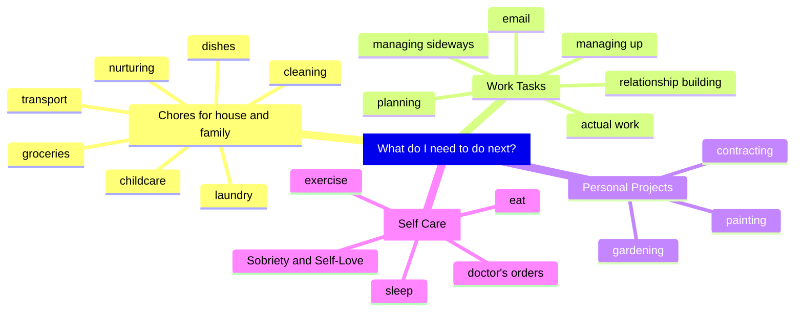
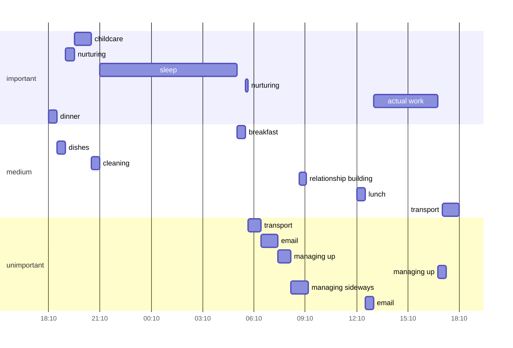
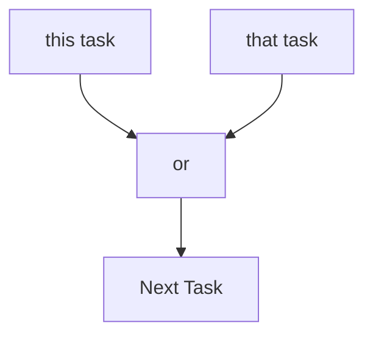

## Why this app?
If you're like me, your daily to-do list lives in your head, looking like this:

It's not chaotic, really, but it's a little overwhelming. It's not really clear where to start. You might write it down on task app a bullet journal or whiteboard, but then you either can't see the whole picture, leave it anchored in one place, or put it down and can't find it later.

More important, you end up doing the wrong work first, and never finding time for the big stones.

### Task Sorter is different.
- It's on your phone so you don't lose it.
- When you enter your tasks, Task Sorter walks you through a sorting algorithm so you rank the tasks from msot to least important.
- You enter how long the tasks take.
- You tell us how long you have to work.

Then Task Sorter walks you through the tasks, one at a time, and tracks your time to keep you focused.

Tasks that are unimportant but urgent displace tasks that that are important, sometimes  completely.

#### So there are five related ideas to distinguish
Importance ≠ Priority ≠ Start Date ≠ End Date minus duration ≠ Deadline
- Importance is about the impact the task has.
- Priority is about what order the tasks happen in.
- Start Date is about when you actually start the task
- End Date is when the task is complete. But not all tasks happen in one single burst.
- Deadline is about when the task must be completed, either for compliance or some other reason.

#### Task Sorter contains (will contain) six related tools to coerce unordered tasks into a priortized list

|           | Sorted   | Unsorted                  | Unordered |
| --------- | -------- | ------------------------- | --------- |
| Grouped   | Projects | Project Planning          | Routines  |
| Ungrouped | Backlog  | Task Sorting (core merge) | Hardstops |
1. Task Sorting: At the heart of the app is my sorting algorithm. This isn't any fancy computing, and there's nothing artificial about it. We've hard coded a recipe that forces you to prioritize your tasks from most to least, using only comparisons between this and that. Instead of an overwhelming list, it's very simple:

2. Backlog: Anything you don't finish gets automatically saved. Next time you login, click "Resume", and your next task will pop up.
3. Hardstops: When you have a hard stop to your work session like lunch with the boss or just 5pm, you record it before you start working. When the hard stop rolls around, Task Sorter saves your progress and sounds an alarm for you to move on. It can even
4. Routines: Some tasks and hardstops repeat, and you don't need to reenter them. If you want, TaskSorter will stop you and remind you to leave work at 3:07 every Tuesday, so you can get your son by 3:50 and your daughter before 4:15 without sitting on your to-do list staring at you all week. And when she's strapped in, tap done, and Task Sorter will merge reminding you to grab a gallon of milk and some chicken breasts before "Make Dinner" starts at 5:15.
5. Project Planning: Not every task is a one-off. Task Sorter supports nested tasks so that you can create projects with sub projects and sub-sub projects, all prioritized and ready to pop up when needed.
6. Projects: Your saved projects sit in your sorted backlog right next to your small tasks. So if you check off "check morning email" at 9:15, "Get a coffee and think about Q4 priorities" can slot itself in for an hour before "meeting to plan client meeting planning meeting" starts at 10:30.

And all of these different tools sit peacefully in the background, doing their job while you focus on the task at hand.
